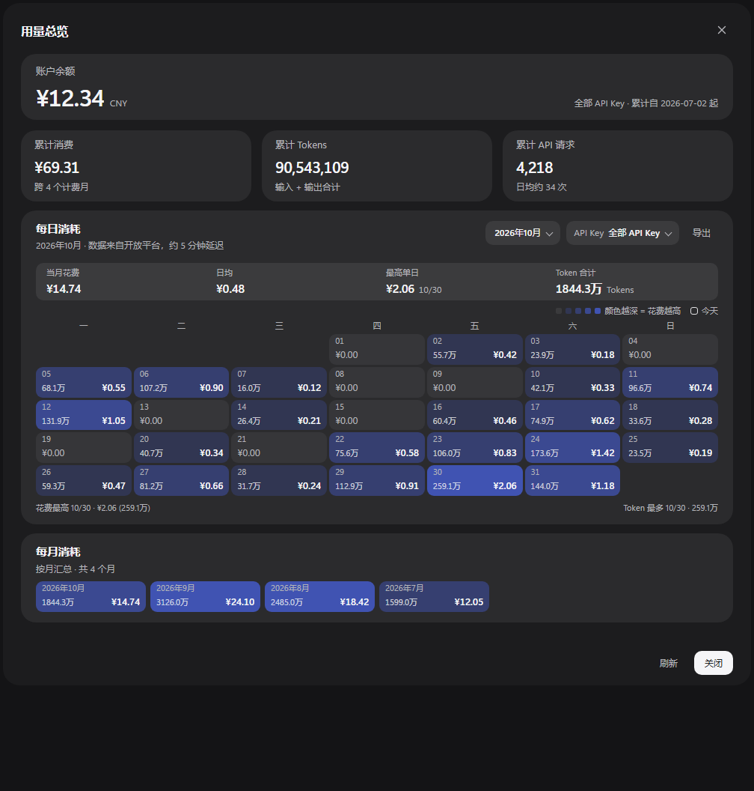

# DeepSeek Harness · Usage Overview

An in-app panel for **DeepSeek Harness (DSH) desktop** that replaces the embedded
`platform.deepseek.com/usage` page behind **设置 → 账号与余额 → 查询用量** with a
readable overview of the whole account:

- account balance, lifetime spend, lifetime tokens and requests;
- a **calendar heat map** of one month: every day shows its spend **and** tokens,
  shaded by how expensive that day was;
- clicking a day opens a small detail popover (spend, tokens, API requests);
- month picker plus a grid of **month tiles** (click one to jump the calendar to it);
- filter by API key, export the selected month as CSV.

> **Not an official DeepSeek product.** It is a community plugin that lives inside
> the DSH desktop profile and uses DSH's extension points.



## Requirements

| | |
|---|---|
| App | DeepSeek Harness **desktop** (tested with `0.2.1-rc.5`, Windows x64) |
| Node.js | 22+ for the installer (DSH ships its own runtime as a fallback) |
| Account | A DSH account that is signed in (the panel reads the existing session) |
| OS | Windows currently tested; the installer uses only Node APIs, other platforms untested |

This is **not** a standalone web app. It is a DSH profile bundle: the Host half adds
one route, the Client half adds one panel to the settings dialog.

## Install

```bash
git clone https://github.com/nTillMeetu/Neko_02.git
cd Neko_02
node install.mjs
```

The installer:

1. finds your DSH profile (`~/.dsh/profiles/desktop`, override with `--profile <dir>`);
2. backs up `package.json` and `pnpm-lock.yaml`;
3. adds `"dsh-usage-overview": "link:<repo path>"` to the profile dependencies;
4. adds `dsh-usage-overview` to `dsh.profile.bundles`;
5. runs `pnpm install` with the pnpm bundled in your DSH runtime;
6. prints the restart step.

Then **restart DeepSeek Harness** and open
**设置 → 账号与余额 → 查询用量**.

Useful flags:

```bash
node install.mjs --dry-run      # show the planned changes only
node install.mjs --profile "C:/Users/you/.dsh/profiles/desktop"
node install.mjs --uninstall    # remove it again
```

### Manual install

If you prefer to edit the profile yourself, add the link dependency and the bundle
entry to `~/.dsh/profiles/desktop/package.json`, then run `pnpm install` from that
directory and restart DSH:

```jsonc
{
  "dependencies": {
    "dsh-usage-overview": "link:D:/path/to/Neko_02"
  },
  "dsh": {
    "profile": {
      "bundles": [
        // ... your existing bundles
        "dsh-usage-overview"
      ]
    }
  }
}
```

## How it works

- **Host** (`lib/index.js`) registers `/usage-overview/summary`. It uses the account
  grant that DSH already holds, calls the Platform `/api/v0/usage/by_api_key/*`
  endpoints (31-day aligned windows, cached), and returns **numbers only**.
- **Client** (`lib/client.js`) renders the panel in a DSH overlay slot and fetches that
  route. It never talks to `platform.deepseek.com` directly.

**Security:** the account token never leaves the Host process and is never sent to the
client; the route returns aggregated totals and daily/monthly buckets. The plugin has
no telemetry and no third-party dependencies at runtime — React and the DSH UI
primitives are provided by DSH itself.

## Caveats

- DSH's plugin APIs (`shell.overlay` slot, profile web server routes, UI primitives)
  are not a stable public contract. A future DSH update can break this plugin; check
  the issue tracker before upgrading DSH.
- The Platform API truncates a single usage query to 31 day-aligned days, so all-time
  and monthly totals are summed from consecutive windows. A monthly total can differ
  from the platform's own lifetime total by a few cents due to rounding.
- The month table starts at the month of the account's first API key; months before
  that are disabled in the picker.

## Uninstall

```bash
node install.mjs --uninstall
```

Then restart DSH. If you installed manually, remove the dependency and the bundle
entry and run `pnpm install` again.

## License

[MIT](LICENSE) © 2026 nTillMeetu

---

## 中文说明

这是给 **DeepSeek Harness 桌面版**用的社区插件，把设置里「账号与余额 → 查询用量」
从内嵌网页换成应用内面板：余额、累计消费/Token/请求、**整月日历热力图**
（每天显示金额和 Tokens，颜色越深花得越多）、点某天看当天明细、按月份切换、
按 API Key 过滤、导出当月 CSV。

**安装：**

```bash
git clone https://github.com/nTillMeetu/Neko_02.git
cd Neko_02
node install.mjs
```

脚本会找到你的 DSH profile（默认 `~/.dsh/profiles/desktop`），备份后写入
`link:` 依赖和 `dsh.profile.bundles`，再用 DSH 自带的 pnpm 安装。
装完**重启 DSH**，打开「设置 → 账号与余额 → 查询用量」即可。

**注意：**

- 只支持 DSH 桌面版，依赖它的内部扩展点，DSH 升级后可能失效；
- 账号 token 只在 Host 进程内使用，接口只返回数字，不会下发到客户端；
- 用 `node install.mjs --uninstall` 可卸载；
- 许可证 MIT。
